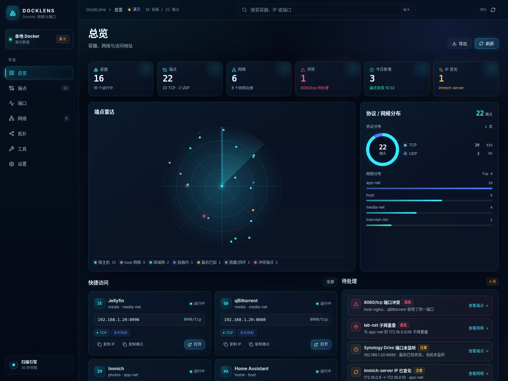
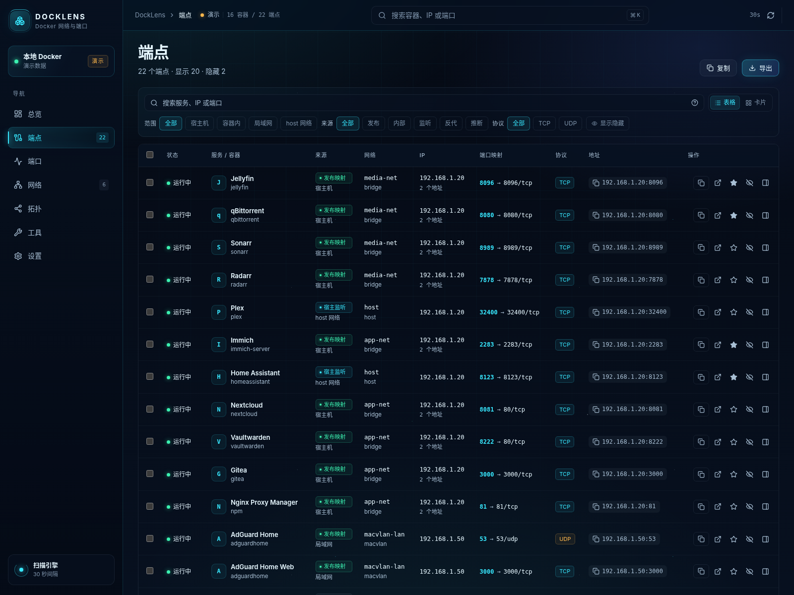

# DockLens

[](https://github.com/MaroD1M/docklens/releases)
[](https://github.com/MaroD1M/docklens/pkgs/container/docklens)
[](LICENSE)

DockLens 是一个 Docker 容器 IP、端口和端点可视化面板。单镜像、单容器、只读采集，打开页面就能看清每个容器在哪个网络、哪个 IP、哪个端口，并直接复制访问地址。

作者 [MaroD1M](https://github.com/MaroD1M) · 仓库 [github.com/MaroD1M/docklens](https://github.com/MaroD1M/docklens)



## 功能

- 统一展示容器、网络、端口、IP 和端点
- 识别发布端口、内部 EXPOSE 端口和 host 网络推断端口
- 支持多网络、多 IP、IPv4 / IPv6
- 一键复制 IP、`IP:Port`、URL、Markdown、JSON、CSV
- 端口矩阵、空闲端口段、端口占用检查
- Docker 子网、网关、IP 池和子网重叠提示
- 容器网络拓扑图
- 收藏、隐藏、标签，持久化到本地
- 深色 / 浅色、移动端、减少动效
- 支持群晖 Container Manager 单容器部署



## 群晖一键部署

Container Manager → 项目 → 新增，项目路径选 `/volume1/docker/docklens`，直接粘贴下面内容。通常只需要修改 `DOCKLENS_LISTEN` 里的端口，其他保持默认。

```yaml
services:
  docklens:
    image: ${DOCKLENS_IMAGE:-ghcr.io/marod1m/docklens}:${DOCKLENS_VERSION:-latest}
    container_name: docklens
    restart: unless-stopped
    network_mode: host
    environment:
      TZ: Asia/Shanghai
      DOCKLENS_LISTEN: 0.0.0.0:7577
      DOCKLENS_DATA_DIR: /data
      DOCKER_HOST: unix:///var/run/docker.sock
    volumes:
      - ./data:/data
      - /var/run/docker.sock:/var/run/docker.sock:ro
    read_only: true
    tmpfs:
      - /tmp
    security_opt:
      - no-new-privileges:true
    healthcheck:
      test: ["CMD", "/docklens", "healthcheck"]
      interval: 30s
      timeout: 5s
      retries: 3
      start_period: 10s
```

也可以直接使用仓库中的 `docker-compose.synology.yml`。启动后访问 `http://<NAS-IP>:7577`。需要固定版本时设置 `DOCKLENS_VERSION`。数据保存在 `./data`，备份时复制该目录即可。

## Docker Compose

从源码构建：

```bash
git clone https://github.com/MaroD1M/docklens.git
cd docklens
cp .env.example .env
docker compose up -d --build
```

使用预构建镜像，不需要本地构建：

```bash
docker compose -f docker-compose.pull.yml pull
docker compose -f docker-compose.pull.yml up -d
```

默认监听 `7577`。使用 bridge 模式时，建议在 `.env` 中设置 `DOCKLENS_HOST_IP` 为 NAS 的局域网 IP，复制出的地址才可访问。只在本机访问时，把 `DOCKLENS_BIND` 改为 `127.0.0.1`。

## 配置

通常只需要改 `DOCKLENS_BIND` 和 `DOCKLENS_PORT`。

| 变量 | 默认值 | 说明 |
|---|---|---|
| `DOCKLENS_BIND` | `0.0.0.0` | 面板绑定地址 |
| `DOCKLENS_PORT` | `7577` | 面板端口 |
| `DOCKLENS_VERSION` | `0.0.1` | 镜像版本；未配置时回退 `latest` |
| `DOCKLENS_HOST_IP` | 空 | bridge 模式下的 NAS 局域网 IP |
| `DOCKLENS_DATA_DIR` | `./data` | 元数据目录 |
| `TZ` | `Asia/Shanghai` | 时区 |

完整变量和部署说明见 [部署文档](docs/DEPLOY.md)。

## 安全说明

- 面板只调用 Docker 只读接口，不提供启停、删除或 Compose 编辑
- Docker socket 以只读方式挂载
- API 不返回容器环境变量值
- 不联网、不遥测、不请求外部 CDN
- 没有内置登录，默认面向可信局域网
- 公网访问请使用 VPN，或在反向代理上增加认证

Docker socket 等价于宿主机高权限，请只运行可信版本的镜像。

## 文档

- [部署文档](docs/DEPLOY.md)
- [API 文档](docs/API.md)
- [安全策略](SECURITY.md)
- [贡献指南](CONTRIBUTING.md)
- [更新日志](CHANGELOG.md)

## 作者

MaroD1M

- GitHub: [github.com/MaroD1M](https://github.com/MaroD1M)
- 仓库: [github.com/MaroD1M/docklens](https://github.com/MaroD1M/docklens)
- 问题反馈: [Issues](https://github.com/MaroD1M/docklens/issues)
- 安全报告: [Security Advisories](https://github.com/MaroD1M/docklens/security/advisories/new)

## License

GNU Affero General Public License v3.0 or later.

Copyright © 2026 MaroD1M. See [LICENSE](LICENSE) and [NOTICE](NOTICE).

基于本项目修改后通过网络提供服务时，也需要按 AGPL-3.0 开放对应源代码。
